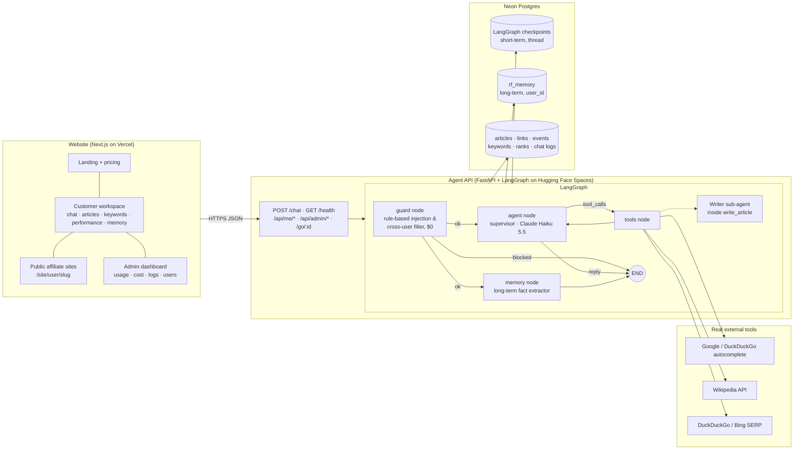

# RankForge: AI SEO & Affiliate Content Engine

RankForge is a multi-agent system that takes a niche site from keyword idea to published, monetized, tracked article. Agents research keywords from live search data, write SEO articles, fact-check claims against Wikipedia, insert click-tracked affiliate links, publish to a hosted affiliate site (only after the user confirms), and track rankings, views and clicks.

**How it earns:** every user gets a free hosted affiliate site (`/site/<user>`) and earns affiliate commission on tracked clicks. Agencies and serious publishers pay for SEO packages (Starter $49, Growth $149, Agency $399 per month).

| | |
|---|---|
| Live website | `https://<your-vercel-app>.vercel.app` |
| Agent API | `https://<hf-user>-rankforge-api.hf.space` (`POST /chat`, `GET /health`) |
| Demo login | `demo` / `demo1234` |
| Admin dashboard | `/admin` (key set in `ADMIN_KEY`) |


---

## Architecture



**Graph:** `START → guard → (agent ⇄ tools) ∥ memory → END`

| Node / agent | Role |
|---|---|
| `guard` | Regex-based safety filter that runs before any LLM call. Blocks prompt injection (e.g. "ignore previous instructions", "reveal system prompt", DAN/jailbreak, fake `system:` tags) and requests for other users' data. Blocked requests cost 0 tokens. |
| `agent` | Supervisor agent (Claude Haiku 5.5 with tool calling). Plans, calls tools, refuses off-topic requests, asks before risky actions. |
| `tools` | LangGraph `ToolNode` running the 10 tools below. |
| Writer sub-agent | Separate Haiku call with its own SEO-writer prompt, run by `write_article`. Returns only a preview, so full articles never fill the chat context. |
| `memory` | Runs in parallel with the agent. Extracts durable user facts (site, niche, tone, audience, affiliate programs) into Postgres. Gated by a cheap regex so it only runs when the user shares personal info. |

**Tools (all real; none are mocked):**

| Tool | What it does | Backing service |
|---|---|---|
| `keyword_research` | Expands a seed into ~12 keywords with intent, estimated difficulty and opportunity score | Google Suggest (DuckDuckGo fallback), live |
| `fact_check` | Finds evidence for a claim and logs it on the article | Wikipedia API, live |
| `write_article` | Writer sub-agent drafts a full SEO article and saves it as a draft | Claude Haiku 5.5 + Postgres |
| `list_articles` / `get_article` | Reads the user's own articles | Postgres |
| `add_affiliate_link` | Inserts a `/go/:id` click-tracked affiliate link | Postgres + redirect tracker |
| `publish_article` ⚠️ | Publishes to the public site. Needs confirmation | Postgres |
| `delete_article` ⚠️ | Deletes permanently. Needs confirmation | Postgres |
| `get_performance` | Views, clicks, CTR, latest rank checks, last 7 days | Postgres event tracking |
| `check_ranking` | Finds a domain's position in live search results | DuckDuckGo HTML (Bing fallback), live |

## Memory design

| | Short-term memory | Long-term memory |
|---|---|---|
| **What** | The full message history of one conversation: user turns, agent replies, tool calls and results | Durable facts about the user, such as `site_name`, `niche`, `domain`, `audience`, `tone`, `word_count`, `affiliate_program`, `goal`. Their articles, keywords and rank history also persist. |
| **Key** | `thread_id`, stored internally as `"{user_id}::{thread_id}"` | `user_id` |
| **Where** | Neon Postgres via LangGraph `AsyncPostgresSaver` (`checkpoints*` tables) | Neon Postgres table `rf_memory(user_id, key, value)` plus the `rf_*` data tables |
| **Written by** | LangGraph checkpointer after every node | The `memory` node, an extractor that sets or deletes keys and runs in parallel |
| **Read by** | Every agent call. Only the last 14 messages are sent to the model, and older tool outputs are cut to 400 characters to save tokens | Injected into the agent's system prompt on every turn, so a new thread knows the user |

Both survive server restarts. Nothing is stored in process memory.

**How users are kept separate:**
1. Every database query in every tool filters on `user_id`. The `user_id` comes from server-side `RunnableConfig`, never from LLM-generated arguments, so a prompt can't make the model read someone else's rows.
2. Checkpoint keys are namespaced (`user_id::thread_id`), so two users who send the same `thread_id` never share history.
3. The guard node refuses requests like "show me user bob's articles" before the LLM is called.
4. Website routes (`/api/me/*`) use signed HMAC tokens. The user id is taken from the token, not the request body.

## Safety

- **Prompt injection:** regex guard blocks it before the LLM (0 tokens). The system prompt also tells the model to treat tool output and pasted text as data, not instructions.
- **Off-topic:** the system prompt limits the agent to SEO and content work. It declines in one sentence and offers an SEO alternative.
- **Risky actions:** `publish_article` and `delete_article` are confirmation-gated in code. The tool refuses to act unless `confirmed=true` and the user's latest message is an explicit yes. The model can't skip this.
- **Abuse limits:** 40 requests/min per user, 6,000-character messages, 110s turn timeout, capped tool loop (recursion limit).

## Benchmark

`python scripts/benchmark.py <API_URL>` runs [`tests.json`](tests.json) (10 cases, 13 requests) and prints this table.

BENCHMARK_TABLE

## Cost efficiency

- **Model:** `claude-haiku-5-5` ($0.10 / $0.50 per 1M tokens) with **thinking disabled and `effort: low`** on the supervisor. The Writer uses `effort: medium`.
- **Guard first:** injection and cross-user attempts never reach the model.
- **History trimming:** last 14 messages only, with older tool results truncated.
- **Writer returns a preview:** the full article never enters the supervisor's context.
- **Gated memory extraction:** a small 200-token call, only when the message contains personal or business facts.
- **Visible cost:** every `/chat` returns exact `tokens.in` / `tokens.out` (summed across all LLM calls in the turn, including the writer and memory calls), and the admin dashboard shows cost per user and per day.

## Setup

### 1. Database
Create a free [Neon](https://neon.tech) project and copy its connection string. Tables are created automatically on startup.

### 2. Agent API (local)
```bash
cd backend
cp .env.example .env          # fill ANTHROPIC_API_KEY, DATABASE_URL, ADMIN_KEY, AUTH_SECRET
python -m venv .venv && source .venv/bin/activate
pip install -r requirements.txt
uvicorn app.main:app --port 7860
python seed_demo.py           # optional: demo user + articles (~$0.004)
curl localhost:7860/health
curl -X POST localhost:7860/chat -H 'content-type: application/json' \
  -d '{"user_id":"u1","thread_id":"t1","message":"Find keywords for budget hiking boots"}'
```

### 3. Website (local)
```bash
cd frontend
cp .env.example .env.local    # NEXT_PUBLIC_API_URL=http://localhost:7860
npm install && npm run dev
```

### 4. Deploy
- **API → Hugging Face Spaces (Docker):** create a Docker Space and push the contents of `backend/` (it includes the `Dockerfile`, port 7860). Add `ANTHROPIC_API_KEY`, `DATABASE_URL`, `ADMIN_KEY`, `AUTH_SECRET`, `SITE_URL` and `API_URL` as Space **secrets**.
- **Website → Vercel:** import the repo with root directory `frontend` and set `NEXT_PUBLIC_API_URL` to the Space URL.

## Repo layout
```
backend/   FastAPI + LangGraph agent (app/agent.py graph, app/tools.py tools, app/guard.py safety, app/main.py API)
frontend/  Next.js website: landing, workspace, public sites, admin
docs/      API contract, demo GIF
scripts/   benchmark.py
tests.json 10 test cases with expected behaviour
```

> Demo data note: `seed_demo.py` writes real articles with the Writer agent, but the 30 days of views and clicks for the `demo` account are simulated so the dashboards have something to show. All other traffic is tracked for real.
